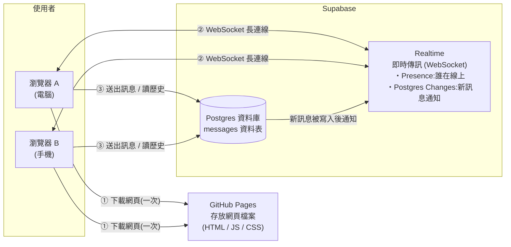
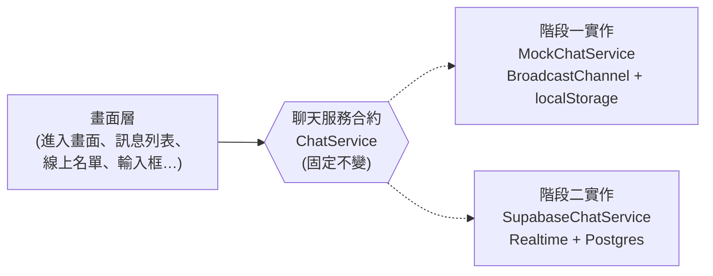
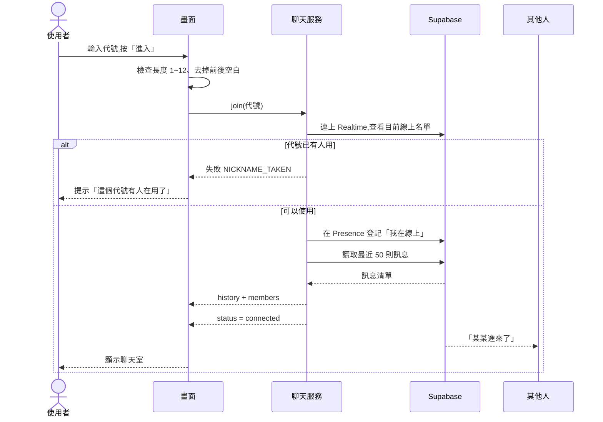
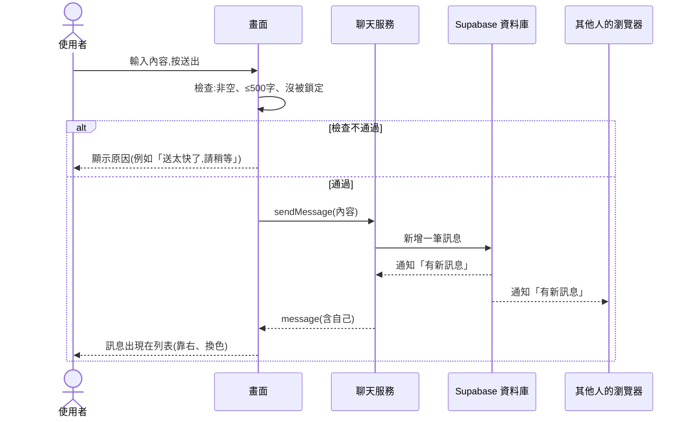
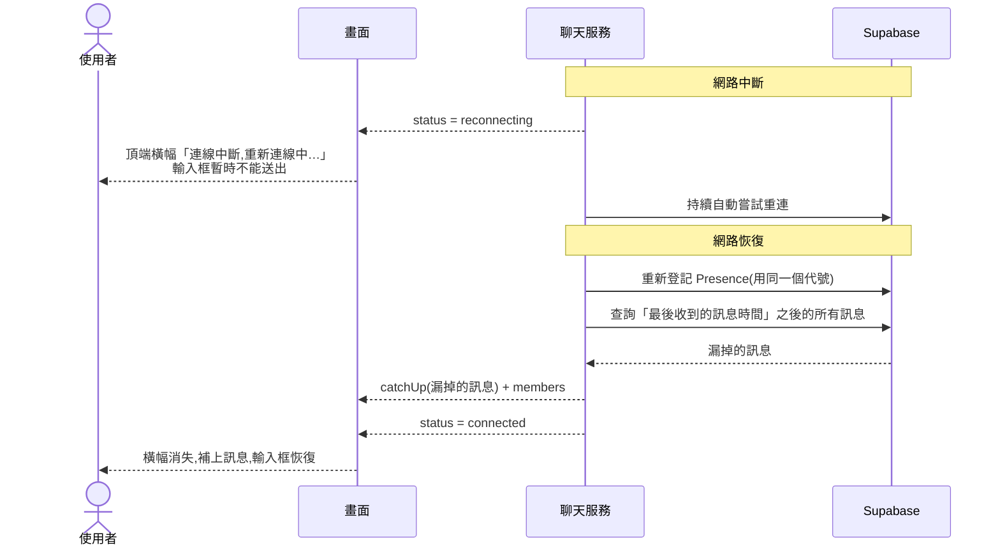

# 匿名聊天室:架構文件

> 讀者:不寫程式的專案負責人。
> 專有名詞第一次出現時,會用一句話解釋。
> 這份文件只講「怎麼設計」,不含程式碼,也不規定顏色與樣式(那是 `/design` 與 `/frontend-design` 的工作)。

---

## 1. 專案說明與目標

**這是什麼**:一個不用註冊、不用登入的匿名聊天室。所有人都在同一個聊天室裡。任何知道網址的人,用電腦或手機都可以進來,輸入一個代號就能聊天。

**使用者會做的事**

1. 打開網頁
2. 輸入代號(1 到 12 個字,中文、英文、數字、emoji 都可以)
3. 進入聊天室,看到最近約 50 則訊息,也看得到誰在線上
4. 送出文字訊息(可以包含 emoji)
5. 關掉網頁就是離開

**專案目標**

- 手機和電腦都好用
- 完全免費(GitHub Pages 與 Supabase 的免費方案)
- 先把畫面做出來、放到網路上看得到,最後才接上真正的即時傳訊
- 接上即時傳訊時,畫面部分不需要重寫

---

## 2. 整體架構圖

先解釋三個角色:

- **瀏覽器**:使用者手上的 Chrome、Safari 等。聊天室的畫面和邏輯都在這裡執行。
- **GitHub Pages**:GitHub 提供的免費網頁空間。它只負責「把網頁檔案送給瀏覽器」,不會處理任何聊天內容。
- **Supabase**:一個現成的後端服務(幫你處理資料庫與即時傳訊的雲端服務)。所有人的訊息都要經過它,才能傳給其他人。



**怎麼讀這張圖**

- ① 使用者打開網址時,瀏覽器從 GitHub Pages 下載網頁。這一步只發生一次。
- ② 網頁載入後,瀏覽器會和 Supabase 建立一條 **WebSocket**(一條開著不關的雙向連線,讓伺服器可以隨時主動把新訊息推給你,不用你一直問「有新訊息嗎?」)。
- ③ 送出訊息時,訊息寫進資料庫;資料庫一有新訊息,就透過 ② 的連線通知所有人。

**重點**:GitHub Pages 只能放靜態檔案(內容固定的檔案),無法執行任何後端程式。所以一定需要 Supabase 來負責即時傳訊。

---

## 3. 技術選擇

每一項都寫「選了什麼」與「為什麼」。

### 3.1 前端

| 項目 | 選擇 | 為什麼 |
|---|---|---|
| 語言 | **TypeScript** | 它是 JavaScript 加上「型別檢查」(寫程式時就能發現資料格式拼錯)。這個專案有很多固定格式的資料(訊息、線上名單、事件),型別檢查能在還沒執行前就抓到錯誤,對由 AI 協助撰寫的專案特別有幫助。 |
| 框架 | **React** | 框架是「蓋畫面的工具組」。React 是目前最普及的選擇,資料變了畫面就自動更新,很適合聊天室這種畫面一直在變的東西。資料多、教學多,出問題也容易找到解法。 |
| 建置工具 | **Vite** | 建置工具負責把我們寫的程式整理成瀏覽器能讀的檔案。Vite 速度快、設定少,並且內建對 GitHub Pages 這種「放在子路徑」的網址的支援。 |
| 樣式 | 由 `/design` 與 `/frontend-design` 決定 | 這份文件不規定顏色、字體、間距。 |
| 深淺色 | 瀏覽器內建的「跟隨系統」機制 | 你選了自動跟隨,不放切換按鈕,所以只需要讓樣式依系統設定切換,不需要額外的程式邏輯。 |

**為什麼不選別的**:純 HTML/JS 在畫面變複雜後(線上名單、訊息列表、斷線橫幅同時更新)會很難維護;Next.js 等需要伺服器的框架,在 GitHub Pages 上用不了完整功能。

### 3.2 Supabase 使用哪些功能

| 需求 | 用的功能 | 為什麼 |
|---|---|---|
| 誰在線上、進入/離開提示 | **Realtime Presence** | Presence 是 Supabase 提供的「在線狀態」功能:每個瀏覽器登記「我在線上」,有人登記或消失時,大家都會收到通知。**使用者關掉分頁或斷線時,Supabase 會自動把他移除**,不需要我們自己判斷誰離開了。這正是線上名單最麻煩的部分。 |
| 新訊息即時推送 | **Realtime Postgres Changes** | 「資料表一有新資料,就通知正在監聽的人」。訊息先存進資料庫,再通知所有人,這樣「存起來」與「即時看到」是同一件事,不會出現「看到了但資料庫沒存」。 |
| 歷史訊息(進入時看最近 50 則;斷線重連補漏) | **Postgres 資料庫 + 一張 `messages` 資料表** | Postgres 是一種資料庫(把資料整齊存放在表格裡的軟體)。瀏覽器用 Supabase 提供的函式庫直接查詢「最近 50 則」,不需要自己寫伺服器。 |
| 擋掉不合規的訊息 | **資料庫的限制規則 + Row Level Security (RLS)** | RLS 是「每一列資料的存取規則」,例如規定:任何人可以讀、可以新增,但**不可修改、不可刪除**。即使有人繞過我們的網頁直接打 Supabase,也會被這層擋住。細節見第 9 節。 |

**為什麼不用 Supabase Broadcast(另一種純轉發、不存資料的訊息功能)**:Broadcast 速度快,但訊息不會存起來,也就沒有「進入時看到最近 50 則」。你已經決定要有歷史訊息,所以用 Postgres Changes 比較單純,只有一個資料來源。

**不用 Supabase 登入功能(Auth)**:你的需求是不要登入。

### 3.3 一個要先知道的限制:進出提示不存進資料庫

你在 Q7 選了「進出提示留在訊息列表裡」。我的設計是:

- **在線上的人**:提示會留在列表中,跟著訊息一起往上捲,不會消失。
- **之後才進來的人**:載入的歷史只有聊天訊息,**看不到更早以前的進出提示**。

**原因**:「離開」是在使用者關掉分頁、斷網、手機鎖屏時發生的,這時瀏覽器已經來不及把「我離開了」寫進資料庫。如果要保存,就得靠伺服器程式去偵測,會讓架構複雜很多。所以第一版只保留「在線上時看到的提示」。這個決定列在第 10 節。

---

## 4. 兩個階段

### 4.1 階段一:還沒接 Supabase

**目標**:做出一個看得到、點得動的完整聊天室,放上 GitHub Pages,讓你先確認畫面與操作手感。

**階段一前端做得到的事**

| 功能 | 階段一做法 |
|---|---|
| 輸入代號、進入 | 完整可用,包含長度、空白檢查 |
| 送出與顯示訊息 | 完整可用,訊息存在這個瀏覽器的記憶體中 |
| 多人聊天效果 | 用瀏覽器內建的 **BroadcastChannel**(同一個瀏覽器的不同分頁之間可以互相傳話的功能)。你**開兩個分頁**,就能看到兩個「人」互相聊天、互相出現在線上名單 |
| 重名檢查 | 可用(在不同分頁之間生效) |
| 進出提示、線上名單 | 可用(分頁開啟/關閉時觸發) |
| 歷史訊息 | 存在瀏覽器的 **localStorage**(瀏覽器內建的小型儲存空間),重新整理後仍看得到最近 50 則 |
| 斷線橫幅與重連 | 提供一個「模擬斷線」的開發用開關,用來檢查橫幅外觀與行為 |
| 送太快鎖定 | 完整可用 |
| 手機版、電腦版版面 | 完整可用 |
| 深淺色 | 完整可用 |
| 假的其他使用者 | 可加一個「示範模式」,自動出現幾個假使用者與訊息,方便你在沒有第二個分頁時檢查長訊息、多人的畫面 |

**階段一的限制**:只有「同一台電腦、同一個瀏覽器」的分頁彼此看得到。你用手機打開同一個網址,**看不到**電腦上的人。這是正常的,真正跨裝置要等階段二。

**怎麼在 GitHub Pages 上看到**:見第 12 節。

### 4.2 階段二:接上 Supabase

階段二做的事:

1. 建立 Supabase 專案、建立 `messages` 資料表與存取規則
2. 取得網址與公開金鑰,設定給前端(第 8 節)
3. 把「假的聊天服務」換成「真的聊天服務」
4. 重新部署

**階段二之後的差別**

| | 階段一 | 階段二 |
|---|---|---|
| 誰看得到彼此 | 同一個瀏覽器的分頁 | 全世界所有打開網址的人 |
| 訊息存在哪 | 你的瀏覽器 | Supabase 資料庫 |
| 線上名單 | 分頁之間 | 真正的線上使用者 |
| 斷線 | 模擬 | 真實的網路斷線 |
| 重名檢查 | 分頁之間 | 全部使用者之間 |
| 時間 | 你電腦的時間 | 資料庫的時間(所有人一致) |

### 4.3 兩階段之間,前端怎麼設計才不用重寫

**核心做法:把「畫面」和「聊天服務」切成兩半,中間只靠一份固定的「合約」溝通。**



**類比**:畫面像「電視」,聊天服務像「訊號來源」。電視只要有 HDMI 孔(合約),不管接的是機上盒還是遊戲機,都能顯示。階段一接「機上盒的假訊號」,階段二換成「真的訊號」,電視本身不用動。

**合約規定的內容**(詳見第 5 節):

- 可以對聊天服務下的指令:進入、送出訊息、離開
- 聊天服務會主動通知畫面的事件:新訊息、有人進來、有人離開、連線狀態改變

**設計規則**

1. 畫面層**完全不知道** Supabase 的存在,不允許在畫面程式裡出現 Supabase 相關的字眼。
2. 兩種實作使用**完全相同的資料格式**(第 5 節)。
3. 用哪一種實作,由**一個設定開關**決定(例如環境設定裡寫 `mock` 或 `supabase`),不用改任何畫面程式。
4. 階段一的假實作要**盡量模仿真的行為**:會延遲一下才收到訊息、會有重名失敗、會有斷線,避免階段二才發現畫面沒處理這些情況。

---

## 5. 通訊約定

這一節是「畫面」與「聊天服務」之間的約定,兩個階段通用。

### 5.1 資料格式

**訊息 (Message)**:一則聊天內容

| 欄位 | 意思 | 規則 |
|---|---|---|
| `id` | 這則訊息的唯一編號 | 由資料庫產生(階段一由前端產生),用來避免同一則顯示兩次 |
| `nickname` | 發送者代號 | 1 到 12 字 |
| `content` | 訊息內容 | 純文字,1 到 500 字,不可全是空白 |
| `createdAt` | 送出時間 | 階段二以資料庫時間為準 |

範例:

```json
{
  "id": "b7e1c0c2-5d7e-4c1a-9f44-0a1f2b3c4d5e",
  "nickname": "小明",
  "content": "大家好 👋",
  "createdAt": "2026-10-13T09:30:00Z"
}
```

**在線使用者 (Member)**:線上名單的一個人

| 欄位 | 意思 |
|---|---|
| `nickname` | 代號 |
| `joinedAt` | 進入時間(重名時用來判斷誰先到) |

**系統提示 (SystemNotice)**:進出提示,**只在畫面上顯示,不存入資料庫**

| 欄位 | 意思 |
|---|---|
| `kind` | `joined`(進來了)或 `left`(離開了) |
| `nickname` | 代號 |
| `at` | 發生時間 |

**連線狀態 (ConnectionStatus)**:`connecting`(連線中)、`connected`(已連線)、`reconnecting`(重新連線中)

### 5.2 事件名稱

**畫面 → 聊天服務(指令)**

| 名稱 | 意思 | 成功/失敗 |
|---|---|---|
| `join(nickname)` | 用這個代號進入聊天室 | 成功,或失敗並說明原因:`NICKNAME_TAKEN`(重名)、`NICKNAME_INVALID`(格式不對)、`NETWORK_ERROR` |
| `sendMessage(content)` | 送出一則訊息 | 成功,或失敗:`TOO_LONG`、`EMPTY`、`RATE_LIMITED`、`NOT_CONNECTED` |
| `leave()` | 主動離開 | 無 |

**聊天服務 → 畫面(通知)**

| 名稱 | 意思 | 帶什麼資料 |
|---|---|---|
| `history` | 進入時載入的最近 50 則訊息 | Message 的清單 |
| `message` | 有一則新訊息(包含自己送出的) | Message |
| `members` | 線上名單更新 | Member 的清單 |
| `notice` | 有人進來或離開 | SystemNotice |
| `status` | 連線狀態改變 | ConnectionStatus |
| `catchUp` | 重連後補上漏掉的訊息 | Message 的清單 |

### 5.3 重複與順序的規則

- 畫面收到訊息時,**以 `id` 去重**,同一個 `id` 只顯示一次。這樣重連補漏時,不會出現重複訊息。
- 訊息**依 `createdAt` 由舊到新排列**。
- 自己送出的訊息,也是等聊天服務通知 `message` 才顯示,不在畫面上先偷偷放進去。這樣「畫面上有的訊息,一定是真的存進去了」。

---

## 6. 資料流

### 6.1 進入聊天室



要點:

- 通過後,代號會記在**瀏覽器 localStorage**,下次打開網頁時自動帶入輸入框,但仍需按「進入」。
- **重名檢查的極限情況**:兩個人在同一瞬間用同一個代號,可能都通過第一次檢查。補救規則:登記完成後,服務會再檢查一次線上名單,如果同一代號有兩人,**`joinedAt` 較晚的人被退回**並看到重名提示。

### 6.2 送出訊息



要點:

- 送出成功後,輸入框清空。
- **送太快**:5 秒內超過 5 則,輸入框鎖住 5 秒並提示。這個計算在前端進行(見第 9 節的說明)。
- 新訊息出現時的捲動行為:停在底部就自動捲到最新;正在往上看,則不動,並顯示「有新訊息 ↓」按鈕。

### 6.3 離開

兩種情況:

| 情況 | 發生什麼事 |
|---|---|
| 使用者關掉分頁/關瀏覽器 | 瀏覽器盡力通知離開,即使失敗,Supabase 也會在連線消失後的短時間內(通常幾秒到幾十秒)自動把他從線上名單移除,其他人看到「某某離開了」 |
| 手機切到背景、鎖屏 | 系統可能會暫停連線,對其他人來說會顯示為離開,回到網頁後會自動重連並重新出現(其他人會看到他又進來) |

注意:這代表**離開提示可能延遲數秒**,屬於正常現象。

### 6.4 斷線重連



要點:

- 補漏靠的是「最後一則收到的訊息時間」,補回來的訊息用 `id` 去重。
- 重連期間你的代號可能被別人佔用(別人以為你已經離開)。若發生,畫面要回到輸入代號畫面並說明原因。
- 若斷線很久(例如超過數分鐘),補漏可能很多則,**最多補最近 200 則**,避免一次載入過多。

---

## 7. 畫面清單

只規定「有哪些元素、各自的行為」,不規定外觀。

### 7.1 畫面一:進入畫面

| 元素 | 行為 |
|---|---|
| 標題/簡短說明 | 說明這是匿名聊天室 |
| 代號輸入框 | 帶入上次使用的代號(若有);最多 12 字;按 Enter 等同按「進入」 |
| 錯誤提示區 | 顯示:代號空白、太長、已被使用、網路錯誤 |
| 「進入」按鈕 | 檢查通過後送出;等待期間按鈕顯示「進入中」並暫時不能重複按 |
| 目前線上人數(選用) | 若能取得就顯示,讓人知道有沒有人在 |

### 7.2 畫面二:聊天室

#### 整體版面

| | 電腦 | 手機 |
|---|---|---|
| 線上名單 | 固定在側欄 | 收在按鈕裡,點開才看到 |
| 訊息列表 | 占主要區域 | 占滿畫面 |
| 輸入區 | 在底部 | 在底部,鍵盤彈出時維持在鍵盤上方 |

#### 元素

| 元素 | 行為 |
|---|---|
| **頂部列** | 顯示聊天室名稱、自己的代號、離開按鈕;手機上額外有「N 人在線」按鈕 |
| **連線橫幅** | 平常不顯示。斷線時出現「連線中斷,重新連線中…」,恢復後自動消失 |
| **訊息列表** | 由舊到新;進入時載入最近 50 則;自己的訊息靠右換色,別人靠左 |
| **訊息(單則)** | 顯示代號、內容、時間;內容只顯示為純文字,網址不會變成可點的連結 |
| **進出提示** | 灰色小字一行,例如「小明 進來了」,夾在訊息之間,跟著往上捲 |
| **「有新訊息 ↓」按鈕** | 只有在使用者往上翻舊訊息、同時有新訊息進來時才出現;點了跳到最底部並消失 |
| **線上名單** | 列出所有線上代號,自己有標示;有人進出時即時更新;標題顯示人數 |
| **輸入框** | 多行文字;Enter 送出;手機上 Enter 換行,用按鈕送出(避免誤送);顯示剩餘字數(接近 500 時) |
| **送出按鈕** | 內容為空、斷線、被鎖定時不能按 |
| **emoji 按鈕/選單** | 點開顯示一組常用 emoji,點選後插入輸入框游標處;也可以用手機鍵盤自己輸入 emoji |
| **鎖定提示** | 送太快時,輸入框暫停數秒,並顯示「送太快了,請稍等」,倒數結束自動恢復 |

#### 其他狀態

| 狀態 | 畫面該怎麼做 |
|---|---|
| 載入歷史中 | 訊息區顯示「載入中」 |
| 沒有任何訊息 | 顯示「還沒有人說話,來打個招呼吧」 |
| 代號被別人佔用(重連後) | 退回進入畫面並說明原因 |

### 7.3 深淺色

所有畫面都要有深色與淺色兩種配色,**跟隨裝置設定自動切換**,不提供手動切換按鈕。

---

## 8. 金鑰

**金鑰 (key)** 是一串文字,用來向 Supabase 證明「這個請求是我的專案發出的」。有的金鑰可以公開,有的絕對不行。

### 8.1 這個專案會碰到的東西

| 名稱 | 是什麼 | 能公開嗎 | 放在哪裡 |
|---|---|---|---|
| **Project URL** | 你的 Supabase 專案網址,長得像 `https://xxxx.supabase.co` | 可以 | 前端設定 |
| **Publishable key**(舊名:**anon key**) | 「公開金鑰」。給網頁用的,權限很低,**能做的事完全由 RLS 規則決定** | 可以。**它設計上就是會被所有人看到的**,任何人打開瀏覽器開發者工具都看得到 | 前端設定,打包進網頁 |
| **Secret key**(舊名:**service_role key**) | 「萬能金鑰」。可以**無視所有存取規則**,讀、改、刪全部資料 | **絕對不行** | **這個專案完全不會用到**,所以任何地方都不該出現 |
| **資料庫密碼** | 建立專案時設定的密碼,用來直接連資料庫 | **絕對不行** | 只存在你的密碼管理工具;專案裡不需要 |
| **Supabase 帳號密碼 / Access Token** | 登入 Supabase 後台的憑證 | **絕對不行** | 只留在你自己手上 |

> **為什麼 publishable key 公開也沒關係?** 它只是一張「訪客證」,能進大門,但房間能不能進、能不能動東西,由 RLS 規則決定。我們的規則是:只能讀訊息、只能新增訊息,不能修改也不能刪除。
> 所以真正要保護的不是這把金鑰,而是 **RLS 規則設對了沒有**(見第 9 節)。
>
> Supabase 近期把金鑰名稱改了(舊稱 anon / service_role,新稱 publishable / secret),兩種說法在後台和教學裡都可能出現。要用的永遠是「公開、權限低」的那一把。

### 8.2 怎麼產生

1. 在 Supabase 後台建立一個新專案
2. 到專案的設定頁(Settings → API / API Keys)
3. 複製 **Project URL** 與 **Publishable key (anon)**,**只複製這兩個**
4. 同一頁面還會看到 Secret key / service_role,**不要複製、不要貼到任何地方**

這些是你在網頁後台點出來的,不需要寫程式產生。階段二時我會逐步帶你操作。

### 8.3 放在哪裡

| 情境 | 放置位置 |
|---|---|
| 你在自己電腦上開發 | 專案根目錄的 `.env.local` 檔案(**環境變數檔**:專門放設定值的檔案,程式啟動時讀取)。這個檔案**不會上傳到 GitHub** |
| 讓別人知道要填什麼 | 專案裡有一個 `.env.example` 範本,只列出欄位名稱,**值都是空的或假的**,這個檔案會上傳 |
| 部署到 GitHub Pages | 放在 GitHub 專案設定的 **Actions secrets / variables**(GitHub 提供的保管箱),建置時才帶入 |

需要的設定欄位只有三個:

- 聊天服務用哪種實作(`mock` 或 `supabase`)
- Project URL
- Publishable key

### 8.4 怎麼避免被 commit 到 GitHub

**commit** 是把檔案的變動記錄進 Git 版本紀錄,上傳到 GitHub 後,即使你之後刪掉,**歷史紀錄裡仍然看得到**。所以要在一開始就預防。

1. `.gitignore`(告訴 Git 哪些檔案不要追蹤的清單)裡**第一天就加入** `.env`、`.env.local`、`.env.*.local`
2. 只允許 `.env.example` 被追蹤,裡面不放真值
3. 每次 commit 之前,請 AI 助理檢查要提交的檔案清單中沒有 `.env*`(`.env.example` 除外)
4. 開啟 GitHub 的 **Secret scanning**(GitHub 內建的功能,會自動偵測誤上傳的金鑰並通知你)
5. 絕對不要把 Secret key 貼到對話、issue、README、截圖裡

**萬一誤 commit 了**:立刻到 Supabase 後台重新產生(rotate)該金鑰,舊的就失效。刪掉檔案沒有用。

---

## 9. 安全與限制

### 9.1 別人可以送什麼奇怪的東西進來

因為沒有登入,**任何人都可以送任何東西**,包含繞過我們的網頁,直接對 Supabase 發請求。我們分兩層防守:

- **第一層(前端)**:改善使用體驗,擋掉一般人的誤操作
- **第二層(Supabase 規則)**:真正的防線,即使有人繞過前端也擋得住

| 可能發生的狀況 | 第一層:前端 | 第二層:Supabase |
|---|---|---|
| **超長訊息** | 輸入框限制 500 字 | 資料表規定 `content` 長度必須在 1 到 500 之間,超過就拒絕寫入 |
| **空白訊息** | 送出鈕不可按 | 資料表規定不可只有空白 |
| **超長/空白代號** | 進入畫面檢查 1 到 12 字 | 資料表規定 `nickname` 長度 1 到 12 |
| **惡意程式碼**(例如訊息裡夾帶 `<script>`,企圖在別人的瀏覽器執行,這叫 **XSS**) | 所有內容**一律當純文字顯示**,不使用會把文字當網頁解析的功能。React 預設就是這樣,規則是**禁止使用任何繞過這個保護的寫法** | 無(靠前端的顯示方式) |
| **假冒別人的代號** | 無法完全防止(見下方說明) | 無 |
| **修改或刪除別人的訊息** | 前端沒有這類按鈕 | RLS 規則:只允許讀取與新增,**不允許修改與刪除** |
| **洗版(短時間大量訊息)** | 5 秒內超過 5 則,鎖定 5 秒 | 見下方說明 |
| **亂塞欄位**(送出多餘的欄位) | 只送定義好的欄位 | 資料表只有固定欄位,多的會被拒絕 |
| **網址、連結** | 當成普通文字顯示,不會變成可點的連結,避免釣魚連結 | 無 |
| **不可見字元、極端的 emoji 組合** | 去掉前後空白;顯示區域允許長字串自動換行,避免版面被撐壞 | 無 |

**已知的限制(第一版接受的)**

1. **代號無法保證不被冒用**。沒有登入,任何人都能用任何代號發言(只要該代號當下不在線上)。重名檢查只擋「同時在線」。
2. **洗版防護是前端的**。真正想搞破壞的人可以繞過前端,繞過後每秒都能送。第一版接受這個風險,因為聊天室規模小。如果之後真的被洗版,可以加上資料庫端的頻率限制,或在 Supabase 設定。
3. **沒有管理者**。無法刪除不當訊息,無法踢人(你在 Q11 選擇不做)。必要時,你可以直接進 Supabase 後台手動刪除資料。
4. **訊息內容公開**。任何知道網址的人都看得到所有訊息。不要在這裡分享個資。

### 9.2 免費方案要注意的上限

以下數字依我寫文件時的印象,**可能已經變動,階段二開始前請以 Supabase 官方定價頁為準**。

| 項目 | 免費方案的限制(約略) | 對這個專案的影響 |
|---|---|---|
| **專案暫停** | **一段時間(約一週)沒有任何活動,專案會被自動暫停**,需要你到後台手動恢復 | 最需要注意的一項。很少人用時,聊天室可能突然連不上。恢復後資料還在 |
| **同時連線數** | Realtime 同時在線的連線約 200 個 | 超過就連不上。對一般分享給朋友的規模夠用 |
| **每秒訊息量** | Realtime 每秒訊息數有上限 | 一般聊天不會碰到;被洗版時可能碰到 |
| **資料庫大小** | 約 500 MB | 純文字訊息很小,幾十萬則都不至於滿 |
| **流量** | 每月有傳輸量上限 | 純文字很省,一般不會碰到 |
| **GitHub Pages** | 網站大小、每月流量有上限(流量約 100 GB/月) | 純文字聊天室遠低於上限 |
| **GitHub Pages 公開** | 免費方案的專案必須是**公開**的 | 程式碼任何人都看得到,所以第 8 節才強調不要放機密 |

---

## 10. 這一版刻意不做的事

| 不做的事 | 為什麼 |
|---|---|
| 註冊、登入 | 你的需求 |
| 圖片上傳、貼圖 | 你選了只做 emoji。圖片會牽涉檔案大小、儲存空間、不當內容,複雜度高很多 |
| 「某某正在輸入…」 | 要多傳很多即時訊號,對匿名聊天室幫助不大 |
| 管理者、踢人、刪訊息 | 與「不用登入」衝突,因為沒有辦法辨別誰是管理者 |
| 保證代號不被冒用 | 同上,沒有登入就沒有「身分」 |
| 進出提示的歷史紀錄 | 離開時無法可靠地寫入資料庫(見 3.3) |
| 私訊、多個聊天室、@提及 | 超出「所有人在同一個聊天室」的需求 |
| 訊息修改、刪除、回覆 | 第一版保持簡單 |
| 網址自動變連結 | 避免釣魚連結與額外的安全風險 |
| 推播通知 | 需要註冊服務與使用者授權,而且 GitHub Pages 上實作複雜 |
| 手動深淺色切換 | 你選了自動跟隨 |
| 資料庫端的洗版防護 | 第一版先靠前端,真的被洗再補 |
| 自動刪除舊訊息 | 目前預設全部保留,只載入最近 50 則;若資料量變大再處理 |
| 多語系介面 | 介面只有繁體中文 |
| 自動化測試的完整覆蓋 | 第一版以第 13 節的人工驗證清單為主 |

---

## 11. repo 的資料夾結構

**repo (repository)** 是專案的資料夾,放在 GitHub 上,整個專案的所有檔案與修改紀錄都在裡面。

```
.
├── .github/
│   └── workflows/
│       └── deploy.yml            # GitHub 自動部署的設定(第 12 節)
├── docs/
│   ├── requirements.md           # 需求說明
│   └── architecture.md           # 本文件
├── supabase/
│   └── schema.sql                # 階段二用:建立資料表與存取規則的說明檔
├── public/                       # 原樣複製到網站的檔案(圖示等)
├── src/
│   ├── main.tsx                  # 程式進入點
│   ├── App.tsx                   # 決定現在顯示進入畫面還是聊天室
│   ├── types.ts                  # 第 5 節定義的資料格式
│   ├── config.ts                 # 讀取環境設定,決定用哪個聊天服務
│   ├── chat/
│   │   ├── ChatService.ts        # 「合約」:聊天服務必須提供的指令與通知
│   │   ├── MockChatService.ts    # 階段一:假的聊天服務
│   │   ├── SupabaseChatService.ts# 階段二:真的聊天服務
│   │   └── useChat.ts            # 讓畫面方便使用聊天服務的橋接
│   ├── screens/
│   │   ├── JoinScreen.tsx        # 進入畫面
│   │   └── ChatScreen.tsx        # 聊天室畫面
│   ├── components/
│   │   ├── MessageList.tsx       # 訊息列表(含捲動行為、新訊息按鈕)
│   │   ├── MessageItem.tsx       # 單則訊息
│   │   ├── NoticeItem.tsx        # 進出提示
│   │   ├── MemberList.tsx        # 線上名單
│   │   ├── Composer.tsx          # 輸入區(輸入框、送出、emoji)
│   │   ├── EmojiPicker.tsx
│   │   └── ConnectionBanner.tsx  # 斷線橫幅
│   ├── lib/
│   │   ├── validation.ts         # 代號與訊息的檢查規則(長度、空白)
│   │   └── rateLimit.ts          # 送太快的計算
│   └── styles/                   # 由 /design 與 /frontend-design 產出
├── .env.example                  # 設定欄位範本(不含真值)
├── .gitignore                    # 排除 .env.local 等不該上傳的檔案
├── index.html
├── package.json                  # 專案用到的套件清單
├── tsconfig.json                 # TypeScript 設定
├── vite.config.ts                # 建置設定(含 GitHub Pages 的子路徑)
└── README.md                     # 如何在本機執行、如何部署
```

**重點**

- `chat/` 資料夾是「聊天服務」,`screens/` 與 `components/` 是「畫面」。畫面的檔案**不准引用** `SupabaseChatService.ts`,只能透過 `ChatService.ts` 的合約。這是第 4.3 節規則的具體落實。
- `src/styles/` 先留給設計工作。
- 如果 `/design` 產出的檔案放在別處,到時再調整。

---

## 12. 部署到 GitHub Pages

**部署**就是把做好的網頁放到網路上讓別人看得到。

### 12.1 做法:用 GitHub Actions 自動部署

**GitHub Actions** 是 GitHub 內建的自動化機器人。我們設定好之後,**每次你把修改推上 `main` 分支,它就會自動:**

1. 下載專案
2. 安裝套件
3. 建置(把原始碼整理成最終的網頁檔案)
4. 把結果發佈到 GitHub Pages

你不需要手動上傳任何檔案。

### 12.2 一次性的設定(階段一開始時)

1. 到 GitHub 專案的 **Settings → Pages**,把 Source 選為 **GitHub Actions**
2. 專案放有 `.github/workflows/deploy.yml`(設定檔我來寫)
3. 推上 `main` 後,到 **Actions** 分頁看執行狀況,綠色勾勾表示成功
4. 網址會是 `https://<你的GitHub帳號>.github.io/<repo名稱>/`

### 12.3 要特別注意的一點:子路徑

GitHub Pages 的網址有 repo 名稱在後面(`.../<repo名稱>/`),不是根目錄。建置設定必須告訴 Vite 這件事(`vite.config.ts` 的 base 設定),否則網頁會一片空白,因為找不到檔案。

### 12.4 階段一與階段二的部署差別

| | 階段一 | 階段二 |
|---|---|---|
| 聊天服務設定 | `mock` | `supabase` |
| 需要設定的 GitHub Secrets/Variables | 不需要 | Project URL、Publishable key |
| 流程 | 推上 main → 自動部署 | 同左,建置時帶入設定值 |

### 12.5 其他注意事項

- 網頁只有一頁(不做多個網址路徑),避免在 GitHub Pages 上重新整理時出現「找不到頁面」。
- 部署後如果看到舊版,瀏覽器可能快取了舊檔案,用強制重新整理(電腦:Ctrl+Shift+R)即可。

---

## 13. 驗證清單

### 13.1 階段一:全部勾完才算完成

**網址與部署**

- [ ] GitHub Pages 的網址可以打開,不是空白頁
- [ ] 重新整理後頁面仍然正常
- [ ] 電腦(Chrome 與 Safari 或 Firefox 至少兩種)與手機(iOS 或 Android)都可以打開

**進入流程**

- [ ] 輸入框空白或只有空格,無法進入,且有提示
- [ ] 輸入超過 12 字,有提示
- [ ] 中文、英文、數字、emoji 的代號都可以進入
- [ ] 前後空格被自動去掉
- [ ] 第二個分頁用相同代號進入,看到「這個代號有人在用了」
- [ ] 關掉第一個分頁後,第二個分頁就能使用那個代號
- [ ] 關掉網頁再打開,輸入框自動帶入上次的代號,但不會自動進入

**聊天**

- [ ] 兩個分頁可以互相聊天
- [ ] 自己的訊息靠右換色,別人的靠左
- [ ] 每則訊息有代號、內容、時間
- [ ] 送出後輸入框清空
- [ ] 空白訊息無法送出
- [ ] 超過 500 字無法送出,且有字數提示
- [ ] 訊息內容含 `<script>` 或 `<b>粗體</b>`,畫面上原樣顯示為文字,不會執行或變粗體
- [ ] 訊息含網址,顯示為普通文字,不可點
- [ ] emoji 選單可以插入 emoji;鍵盤輸入 emoji 也正常
- [ ] 很長的連續字串(沒有空格)不會把版面撐出畫面

**歷史訊息**

- [ ] 重新整理後,最近 50 則訊息仍在
- [ ] 超過 50 則時,只載入最近 50 則

**線上名單與進出提示**

- [ ] 電腦版:側欄顯示線上名單,有人進出會更新,自己有標示
- [ ] 手機版:名單收在按鈕裡,按鈕顯示人數,點開看得到
- [ ] 有人進來時,列表出現灰色一行「某某 進來了」
- [ ] 有人離開時,出現「某某 離開了」
- [ ] 進出提示會跟著訊息往上捲

**捲動**

- [ ] 停在底部時,新訊息進來自動捲到最新
- [ ] 往上翻舊訊息時,畫面不動,出現「有新訊息 ↓」按鈕
- [ ] 點按鈕跳到最底部,按鈕消失
- [ ] 自己送出訊息時,一定會捲到底部

**送太快**

- [ ] 5 秒內連送超過 5 則,輸入框被鎖定,出現提示
- [ ] 鎖定結束自動恢復

**斷線(用模擬開關)**

- [ ] 模擬斷線時,頂端出現橫幅,送出鈕不可按
- [ ] 恢復後橫幅消失,可以正常送出

**畫面**

- [ ] 手機直向、橫向都沒有橫向捲軸
- [ ] 手機鍵盤彈出時,輸入框不被遮住
- [ ] 系統切換深色/淺色,頁面隨之切換,兩種模式文字都看得清楚
- [ ] 沒有訊息時,顯示「還沒有人說話」之類的提示

**架構檢查**(給開發者)

- [ ] 畫面的程式檔案中,沒有出現 Supabase 的字眼
- [ ] 專案中沒有 `.env.local` 被追蹤
- [ ] 專案中沒有任何金鑰

### 13.2 階段二:全部勾完才算完成

**Supabase 設定**

- [ ] `messages` 資料表已建立,RLS 已開啟
- [ ] 規則確認:匿名使用者**可以讀、可以新增、不能修改、不能刪除**
- [ ] 手動測試:用公開金鑰直接嘗試新增超過 500 字的訊息,被拒絕
- [ ] 手動測試:用公開金鑰直接嘗試修改、刪除訊息,被拒絕
- [ ] 手動測試:新增空白內容、空白代號、超過 12 字的代號,被拒絕

**金鑰安全**

- [ ] GitHub 專案中搜尋 `service_role` 與 `secret`,找不到任何金鑰
- [ ] `.env.local` 沒有出現在 GitHub 上
- [ ] 已開啟 GitHub 的 Secret scanning
- [ ] 打包後的網頁中,只有 Project URL 與 Publishable key,沒有別的金鑰

**跨裝置**

- [ ] 電腦與手機(不同網路,例如手機用行動網路)進同一個聊天室,可以互相聊天
- [ ] 訊息延遲在一兩秒內
- [ ] 線上名單同時顯示電腦與手機上的使用者

**進入與重名**

- [ ] 電腦與手機用相同代號,後進入的被擋下並看到提示
- [ ] 其中一方離開後,代號可以再被使用
- [ ] 兩邊幾乎同時用相同代號進入,最後只有一人留在聊天室

**歷史訊息**

- [ ] 新進來的人看到最近 50 則,順序正確
- [ ] 訊息時間是以資料庫時間為準,兩台裝置看到的時間一致

**離開**

- [ ] 關掉分頁後,其他人在合理時間內(約幾十秒內)看到「離開了」並從名單移除
- [ ] 手機鎖屏再解鎖,可以自動回到聊天室並正常運作

**斷線重連**

- [ ] 關閉 Wi-Fi 後,出現斷線橫幅
- [ ] 斷線期間,另一台裝置送出幾則訊息
- [ ] 恢復網路後,橫幅消失,斷線期間的訊息被補上,**沒有重複**
- [ ] 重連後線上名單正確
- [ ] 斷線期間代號被別人搶走時,畫面回到進入畫面並說明

**安全**

- [ ] 在訊息中輸入 `<script>alert(1)</script>`,所有人看到的都是純文字
- [ ] 洗版測試:快速連送,前端鎖定有效

**部署**

- [ ] GitHub Pages 的網址上,設定為 `supabase` 的版本可以正常運作
- [ ] 重新部署後,聊天室仍然正常
- [ ] Supabase 後台的 Realtime 與資料庫使用量在免費額度內

**免費方案**

- [ ] 已知道專案閒置會被暫停,並知道在哪裡恢復
- [ ] 已記下目前免費方案的實際上限(以官方頁面為準)
